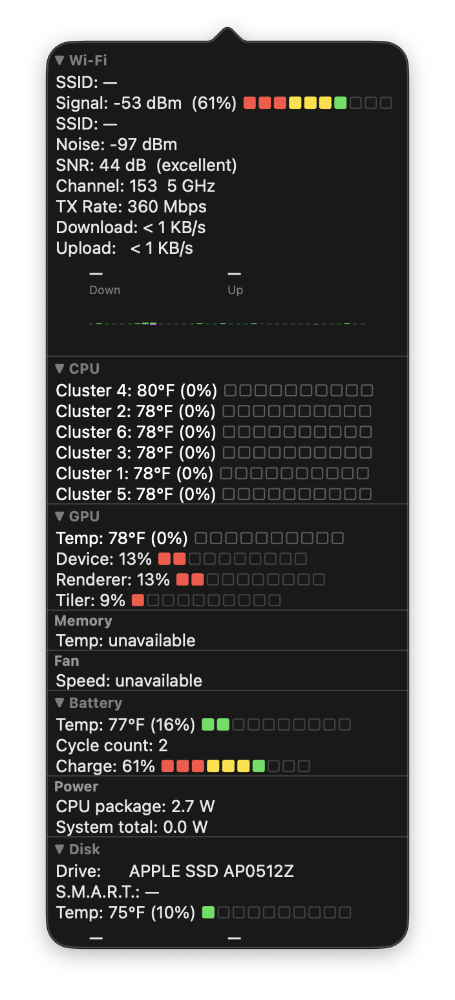
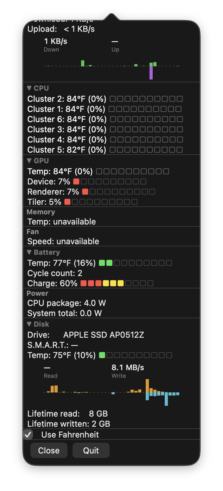

# Vitals

A lightweight macOS menu bar dashboard showing real system stats — Wi-Fi signal, CPU/GPU temps, fan speed, battery health, disk activity, and power draw — all from a single menu bar item with no Dock icon. Works on both Intel and Apple Silicon Macs.

<p align="center">
  
  
</p>

## Menu bar

Updates every 3 seconds (graphs update every 1 second):

```
-56 dBm (57%) ■■■■■■□□□□ │ 125°F
```

- **Wi-Fi**: RSSI in dBm, percentage, color meter
- **CPU**: hottest core/cluster temperature
- Meter squares are color-coded: red → yellow → green (Wi-Fi signal) / green → yellow → red (heat)

## Panel (click status bar item to open/close)

The panel stays open when you click other apps — it closes only when you click the status bar item again or press **Close**. The panel automatically resizes as sections are expanded or collapsed.

Sections marked **▼** are collapsible — click the header to collapse to a single summary row, click again to expand. Collapsed state and temperature unit preference persist across restarts.

The current app version is shown as a dim footer above the Close/Quit buttons.

**Apple Silicon** (M-series — cluster-level sensors):
```
  ▼ Wi-Fi                          ← click to collapse (shows SSID + signal meter)
  SSID:      MyNetwork
  Signal:    -56 dBm  (57%) ■■■■■■□□□□
  Noise:     -88 dBm
  SNR:       32 dB  (excellent)
  Channel:   153  5 GHz
  TX Rate:   243 Mbps
  Security:  WPA2
  Download:  12.3 MB/s
  Upload:    524 KB/s
  [download/upload bar graph]
  ───────────────────────────
  ▼ CPU                            ← click to collapse (shows hottest temp + meter)
  Cluster 1: 114°F (23%) ■■□□□□□□□□
  Cluster 2: 113°F (21%) ■■□□□□□□□□
  Cluster 3: 111°F (20%) ■■□□□□□□□□
  ───────────────────────────
  ▼ GPU                            ← click to collapse (shows temp + meter)
  Temp:      107°F (17%) ■■□□□□□□□□
  Device:    13% ■■□□□□□□□□
  Renderer:  13% ■■□□□□□□□□
  Tiler:      9% ■□□□□□□□□□
  ───────────────────────────
  Memory
  Temp:      unavailable
  ───────────────────────────
  Fan
  Speed:     unavailable
  ───────────────────────────
  ▼ Battery                        ← click to collapse (shows charge + meter)
  Temp:      84°F (30%) ■■■□□□□□□□
  Cycle count: 12
  Charge:    100% ■■■■■■■■■■
  ───────────────────────────
  Power
  CPU package:   9.0 W
  System total:  9.8 W
  ───────────────────────────
  ▼ Disk                           ← click to collapse (hides text rows, graph stays)
  Drive:      APPLE SSD AP0512Z
  S.M.A.R.T.: Verified
  Temp:       77°F (12%) ■□□□□□□□□□
  [read/write bar graph]
  Read since boot:    26 GB
  Written since boot: 9 GB
  ───────────────────────────
  [ ] Use Celsius
  ───────────────────────────
  [ Close ]  [ Quit ]
  Vitals 1.0.0
```

**Intel** (per-core sensors, fan, memory temp):
```
  CPU
  Core 1:    136°F (40%) ■■■■□□□□□□
  Core 2:    129°F (34%) ■■■■□□□□□□
  ───────────────────────────
  Memory
  Temp:      109°F (19%) ■■□□□□□□□□
  ───────────────────────────
  Fan
  Speed:     2200 RPM (35%) ■■■■□□□□□□
```

Sensors are detected dynamically at startup — the app adapts to whatever the SMC exposes. Sections with no available sensor show "unavailable" rather than disappearing.

## Wi-Fi graph

The Wi-Fi section includes a live download/upload bar graph that updates every second and retains ~40 seconds of history:

- **Green bars** (upward) — download rate
- **Purple bars** (downward) — upload rate
- Each half scales independently to its own peak, so upload activity is always visible even when download is much faster
- Current rates are shown above the graph in the Download/Upload rows
- Graph hides when the Wi-Fi section is collapsed

## Disk graph

The Disk section includes a live read/write bar graph that updates every second and retains ~40 seconds of history:

- **Orange bars** (upward) — read rate
- **Teal bars** (downward) — write rate
- Each half scales independently to its own peak
- Current read/write rates are shown above the graph
- Bytes read/written **since the last boot** are shown below — these counters reset at every reboot, not a true device lifetime total
- Graph remains visible even when the Disk section is collapsed

## Signal scale

Wi-Fi percentage maps RSSI to the practical range −90 dBm (0%) → −30 dBm (100%):

| dBm | % | Quality |
|-----|---|---------|
| −30 | 100% | Outstanding |
| −50 | 67%  | Excellent |
| −60 | 50%  | Good |
| −67 | 38%  | Usable minimum |
| −75 | 25%  | Weak |
| −90 | 0%   | Unusable |

CPU/GPU/memory temp percentage maps 86°F (idle, 0%) → 212°F (throttle, 100%). Battery temp uses a separate scale: 68°F (0%) → 122°F (100%). Disk temp uses 68°F (0%) → 140°F (100%).

Temperature unit (°C/°F) is toggled via the "Use Celsius" checkbox and persists across restarts. Defaults to Fahrenheit.

## How it works

CPU/GPU temperature, memory, fan, and disk-temp data is read from the System Management Controller (SMC) via IOKit. GPU utilization (Device, Renderer, Tiler %) comes from the `AGXAccelerator` IOKit registry entry. Battery charge and cycle count come from the `AppleSmartBattery` IOKit registry entry. Disk model, S.M.A.R.T. status, and read/write byte counters come from `IOBlockStorageDriver` and its parent NVMe controller (the byte counters reset at every boot — true device-lifetime totals would require parsing NVMe SMART log pages). Wi-Fi signal and interface stats come from CoreWLAN and `getifaddrs`. No `sudo`, no third-party tools.

Two timers run independently: graphs (Wi-Fi bandwidth, disk I/O) refresh every 1 second; all other stats refresh every 3 seconds. The disk read is shared between the two timers so the driver is polled at most once per second.

Startup events and errors are written to the macOS unified log (subsystem `com.eric.vitals`). View with:

```bash
log show --predicate 'subsystem == "com.eric.vitals"' --info --last 1h
```

## Requirements

- macOS 12 Monterey or later (Intel or Apple Silicon)
- Xcode Command Line Tools: `xcode-select --install`

The binary built by `build.sh` is a universal binary (x86_64 + arm64) and runs natively on both Intel and Apple Silicon Macs. GPU utilization metrics require Apple Silicon; on Intel Macs those rows show "unavailable" while all other sensors work normally.

## Build & run

```bash
git clone https://github.com/eparker71/vitals.git
cd vitals

# Build only
bash build.sh

# Run (stays in menu bar, no Dock icon)
./Vitals &
```

## Auto-start at login

```bash
# Build + install LaunchAgent in one step
bash build.sh --install
```

This generates `~/Library/LaunchAgents/com.eric.vitals.plist` with the correct
path for your machine and loads it immediately. The app will restart automatically
at every login.

To stop and uninstall:

```bash
launchctl unload ~/Library/LaunchAgents/com.eric.vitals.plist
rm ~/Library/LaunchAgents/com.eric.vitals.plist
```

## Files

| File | Purpose |
|------|---------|
| `Vitals.swift` | App source |
| `build.sh` | Compile script (`--install` flag sets up login auto-start) |
| `com.eric.vitals.plist` | LaunchAgent template (path substituted at install time) |
